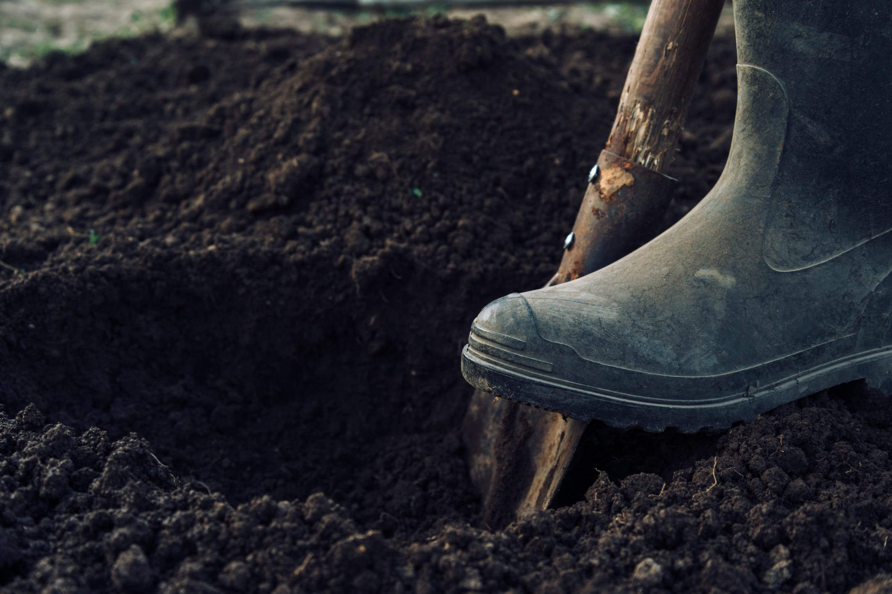

*I strongly recommend you read the original poem by Heaney [here](https://www.poetryfoundation.org/poems/47555/digging) before digging into this writing.*

Some questions are so ancient and instinctive that they seem stitched into the fabric of the human mind. “Who am I?” and “Why am I here?” have echoed through every age, shaping religions, philosophies, and works of art. They are questions that do not fade, but evolve with each generation. Seamus Heaney’s poem *“Digging”* takes up this struggle in a deeply personal way: how does one honor the weight of tradition while still embracing the truth of the self? For Nobel laureate Seamus Heaney, his father’s spade stands as a symbol of inherited identity, while the pen points toward a different kind of digging — the search for an authentic life of words. Heaney reminds us that every generation must choose its own tool, its own way of digging. Whether with spade, pen, computer, or some yet-unimagined instrument, the work is the same: to uncover who we are and what we are meant to become. With a little insight we can unearth the truth about identity.

<figure>
  
  <figcaption><a href="https://www.drchristianconte.com/wp-content/uploads/2015/09/ts_diggingholes.jpg">Photo credit</a></figcaption>
</figure>

For Heaney, the pen is mightier than the spade. His internal struggle of choosing between familial tradition and personal passion is resolved with rejection of the tool that is symbolic of his father and the embrace of a lifestyle centered around writing. By refusing to adopt the identity of his forefathers, Heaney creates one of his own. One that is truer to him, rather than one that was simply inherited. Despite having a great sense of honor and respect for his lineage and the humble occupation that has shaped generations of his family, he respects himself enough to admit that he is not meant to live by the spade as they were. He has the self awareness to not delude himself with the pursuit of something that is not a part of his personal truth. The dichotomy of the archetypal father versus the self lies at the root of the poem.

While many of us might try to emulate our parents at first, few of us are content to be carbon copies. For as many traits that are passed on from parent to child, equally many seem to arise out of nowhere and are completely unique to the individual. “Digging” is a poem of realization, perhaps for the first time, that there is a calling, a passion, an identity inside that is distinct from the environment in which you were raised, and whatever “truth” has been imposed upon you. There is another way, you just have to find it. There is no map, no X to mark the spot. You must find it on your own. For Heaney, digging away at the question (by writing poetry about it) allowed him to fully grasp that awakening. “Digging” was part of Heaney’s debut collection of poetry, *Death of a Naturalist*. Published in 1966, he would go on to receive the Nobel Prize for Literature roughly 30 years later. What would the world have missed if young Seamus Heaney doesn’t embrace his identity?

> “Between my finger and my thumb\
> The squat pen rests.\
> I’ll dig with it.”
>
> — Seamus Heaney, “Digging”

Self-awareness is a distinctly human trait. You do not find philosophy in any other species; it is because we ask questions that we have answers. The constant need to question everything, especially in trying to understand ourselves has propelled us to heights unimaginable to our primitive ancestors. Paradoxically, simple questions are sometimes the hardest to answer. Where logic falls short, people like Heaney step in with their art and offer us glimpses of a truth beyond tradition. That is why we will always have the urge for creative expression. The need to put into paint our powerful imagination, or into words our deepest emotions, is human. We have always done it, and always will. Art exists because we are self aware.

“Digging” is a poem that many of us can relate to; most if not all of us struggle with understanding our identity. There are often conflicting emotions or thoughts that make identity a mystifying enigma. I find myself in a situation similar to Heaney’s in a sense. I will be the first in family to go to college. Back home, my family revolves around the construction business. For many of my teenage years, I painted, scraped ceilings, carried 5 gallon paint buckets all around, 2 at a time. I know it well enough to say that it’s not a career that I’d be fulfilled in. Like Heaney, I’m breaking from “the family trade” to forge my own path into computer science. Maybe many decades from now my work will be as impactful as Heaney’s. Regardless, attaining a better understanding of yourself is a gift in and of itself. In pursuit of these goals, my path has only just begun to be written.

Context: This paper was written for a high school literature class, I thought it deserved a home here. I’m now close to graduating with my bachelor’s degree, and I’m pursuing graduate studies and research related to data science and artificial intelligence. Writing has always been important to me, it’s one of the ways in which I’ve come to know myself. Thank you for reading.
